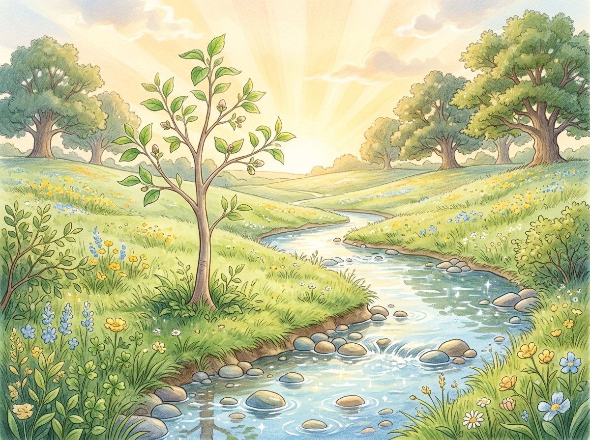
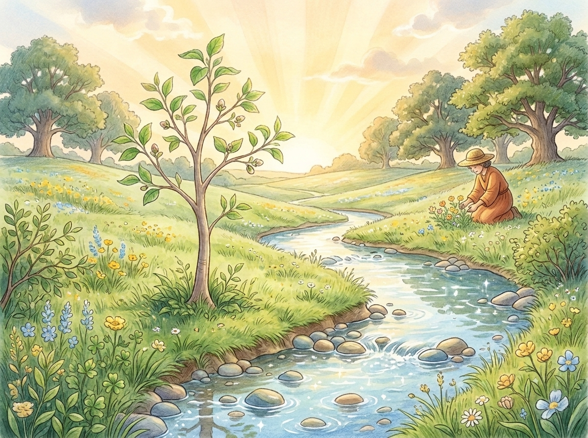
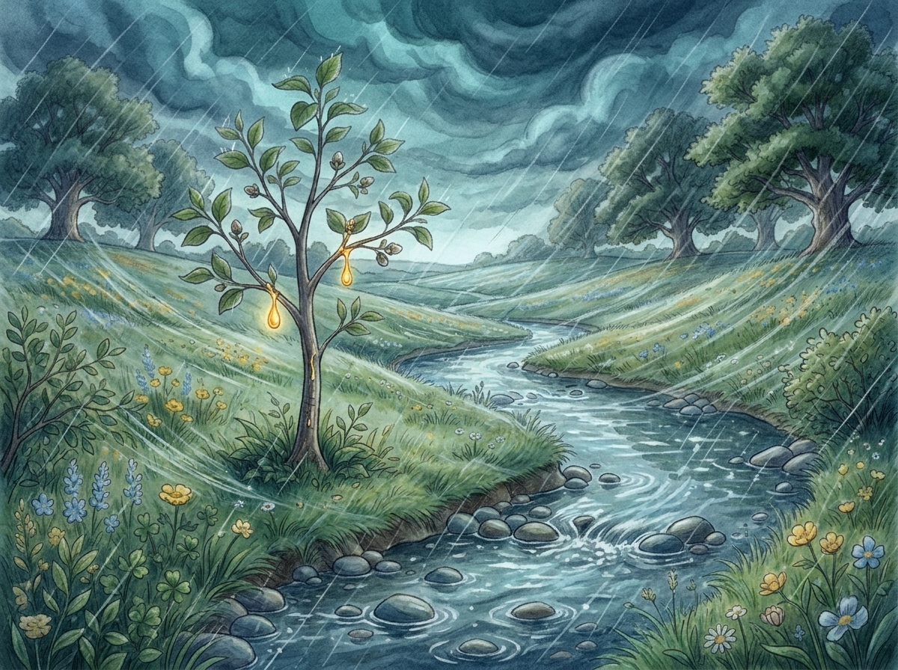
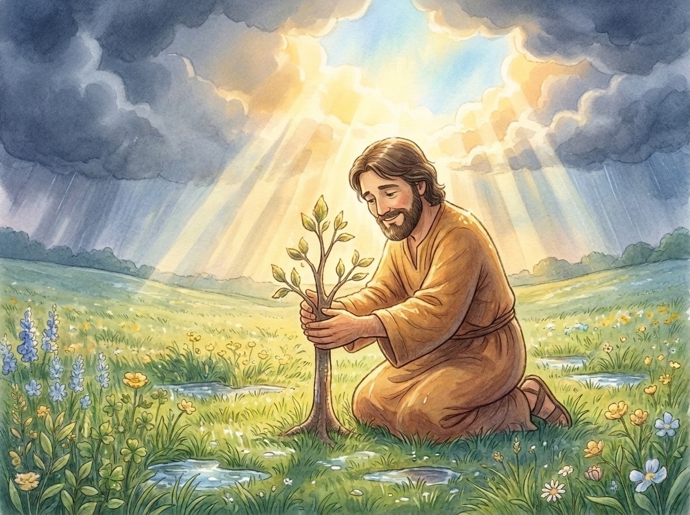
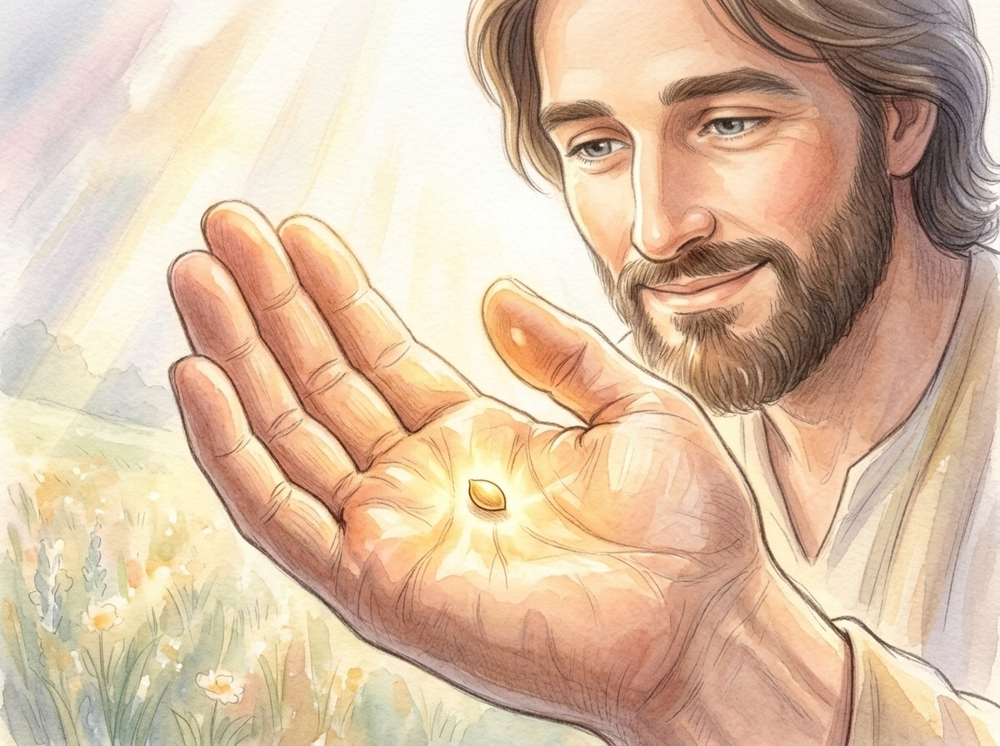
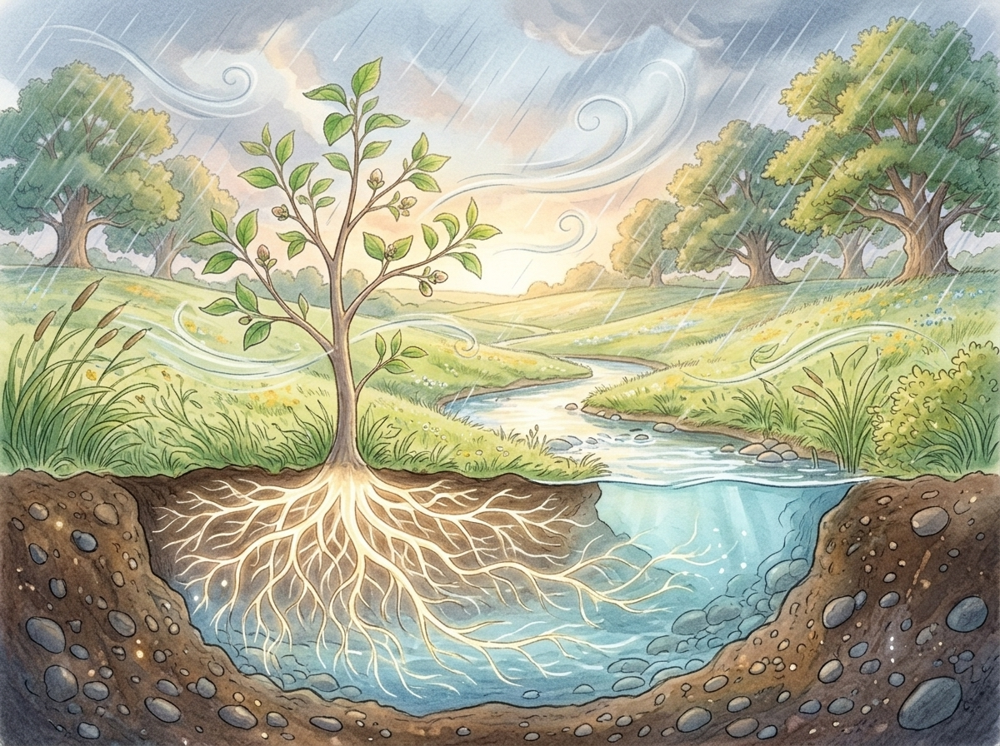
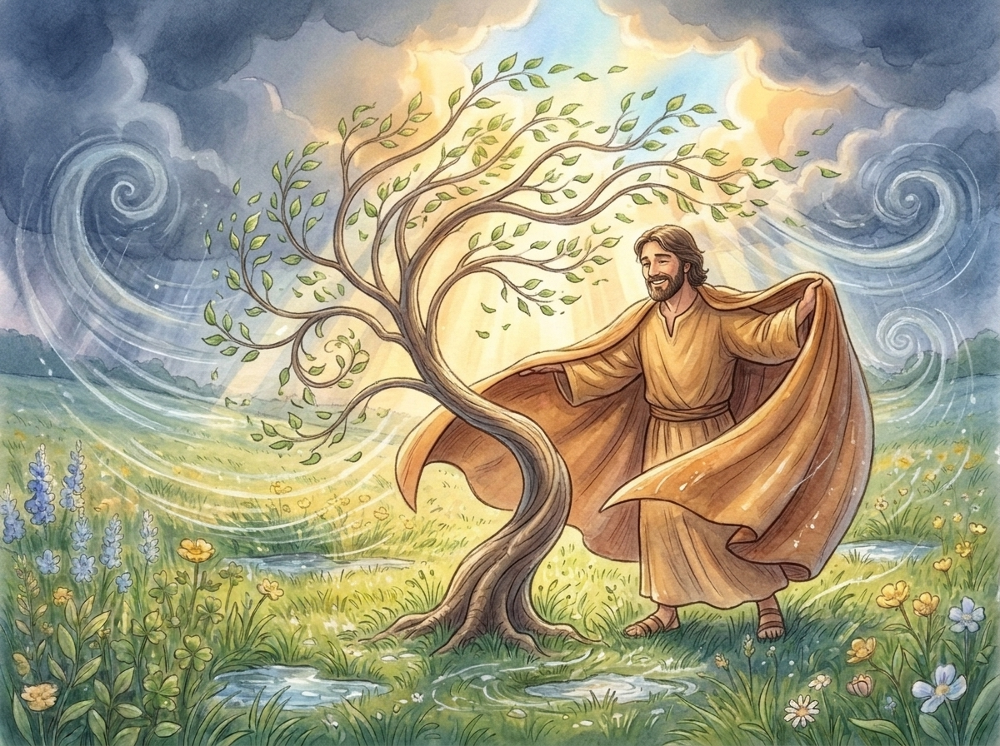
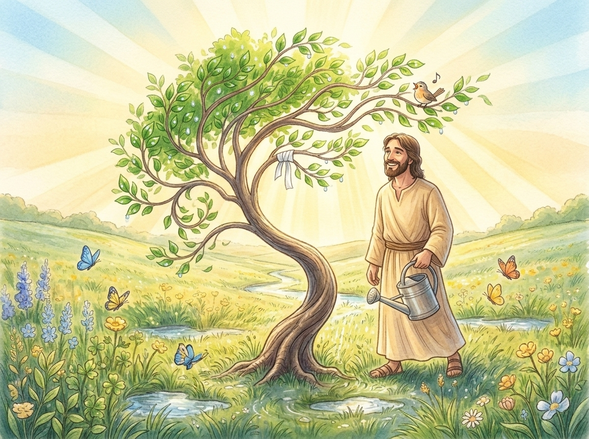

# Der kleine Baum, der wachsen durfte
### Ein christliches Bilder- & Trostbuch über Gnade, Vertrauen und das Loslassen von Leistungsdruck
**Für Kinder von 4 bis 9 Jahren**

---

## Bibelverse als Geleit

> *„Noch ehe ich dich im Mutterleib bildete, habe ich dich gekannt; und ehe du geboren wurdest, habe ich dich geheiligt.“*  
> — **Jeremia 1,5**

> *„Gesegnet ist, wer auf den Herrn vertraut. Er ist wie ein Baum, am Wasser gepflanzt, der seine Wurzeln zum Bach hin streckt. Er fürchtet sich nicht, wenn die Hitze kommt; seine Blätter bleiben grün. Auch in einem dürren Jahr sorgt er sich nicht und hört nicht auf, Frucht zu tragen.“*  
> — **Jeremia 17,7–8 / Psalm 1,3**

---

## Widmung

> *Für dich.*  
> *Du musst die Welt heute nicht tragen.*  
> *Gott hat dich schon gekannt und geliebt, als du noch winzig klein warst.*  
> *Du musst dir Seine Liebe nicht verdienen.*  
> *Atme ein. Atme aus. Du bist in Seinen guten Händen geborgen.*

---

## Die Figuren der Geschichte

* **Bo, das kleine Bäumchen:** Ein junger Baum mit saftig grünen Blättern und einem zarten Stamm. Bo möchte alles perfekt machen. Er denkt, er müsse sich ganz furchtbar anstrengen, damit der Gärtner stolz auf ihn ist und er stark genug für die Welt wird.
* **Der Gärtner (Gott, der Schöpfer):** Er hat die Welt erdacht, den Hügel geformt und jedes Samenkorn in Seinen Händen gewogen. Seine Augen leuchten vor unendlicher Güte, Seine Hände schenken Wärme und Schutz, und Seine Stimme beruhigt selbst die lautesten Stürme.
* **Die lebendige Quelle (Der Geist des Lebens / Gottes Gegenwart):** Ein klarer, kühler Bach, der niemals versiegt und Bos Wurzeln Tag und Nacht nährt.
* **Der Sturm:** Die Ängste, Anforderungen und lauten Sorgen dieser Welt, die an uns rütteln und uns weismachen wollen, wir müssten alles aus eigener Kraft schaffen.

---

---

# Die Geschichte

## Kapitel 1: Am Ufer des Lebenswassers

Es war einmal ein sonniger Hügel, an dessen Fuße ein kleiner, glasklarer Bach entlangmurmelte. Direkt an seinem Ufer, wo das Moos weich wie Samt war und der Duft von frischer Erde in der Luft lag, stand Bo.

Bo war ein junges Bäumchen. Seine Rinde war noch glatt und zartbraun, und seine Zweige reckten sich neugierig in den Himmel wie kleine Hände beim Gebet. An seinen Spitzen sprossen helle Blätter – rund, fein geädert und glänzend im Sonnenlicht.

Bo stand nicht zufällig an diesem Ufer.  
Der Gärtner selbst hatte ihn hierher gebracht. Der Gärtner hatte den Hügel angelegt, die Blumen gesät und den Bach zum Fließen gebracht. Er besuchte Bo jeden Tag, strich sanft über seine Rinde und sah ihn mit Augen an, in denen die ganze Liebe des Himmels lag.

Doch mit der Zeit schaute Bo immer seltener auf den Gärtner – und immer öfter auf die anderen Bäume.

Auf der anderen Seite des Hügels standen riesige, uralte Eichen und mächtige Zedern. Ihre Stämme waren so dick, dass drei Kinder sie nicht umarmen konnten. Ihre Kronen reichten fast bis an die Wolken, und ihr Holz schien hart wie Stein zu sein.

*„Ich muss so werden wie sie“*, flüsterte Bo ehrfürchtig. *„Ich muss schnell groß werden! Ich muss stark, gerade und fehlerlos sein. Nur dann hat der Gärtner Freude an mir. Ich darf keine Schwäche zeigen. Ich darf niemals nachgeben.“*

---

## Kapitel 2: Die große Mühe des kleinen Bo

Von diesem Tag an begann Bo, sich ganz schrecklich anzustrengen.

Sobald der Morgen graute, spannte Bo all seine feinen Äste an. Er presste seine Fasern zusammen, hielt die Luft an und drückte mit aller Gewalt:  
*„Wachse! Streck dich! Höher! Schneller! Härter!“*

Wenn ein kleiner Buchfink sich auf einem seiner Zweige niederlassen und ein Lied singen wollte, dachte Bo gehetzt:  
*„Nicht jetzt! Ich habe keine Zeit für Lieder. Ich muss wachsen! Wenn ich mich ausruhe, verliere ich Zeit. Und wenn ich klein bleibe, bin ich wertlos.“*

Wenn die Gänseblümchen im Gras gähnten und ihre Blütenblätter im Abendlicht schlossen, um Gott für den Tag zu danken und einfach zu schlafen, stand Bo stocksteif da. Er zählte im Stillen seine Blätter: *Eins, zwei, drei ... gestern waren es auch nur siebzehn. Mache ich etwas falsch? Bin ich nicht fleißig genug?*

Bo merkte gar nicht, wie müde sein Holz wurde. Seine Spitzen schmerzten vor Anspannung, und sein Stamm fühlte sich an wie ein Bogen, der viel zu straff gespannt war.  
Bo hatte vergessen, wer er war. Er dachte, er müsse sich die Liebe des Gärtners durch eigene Kraft erarbeiten.

---

## Kapitel 3: Dunkle Wolken am Horizont

Eines Nachmittags verdunkelte sich der Himmel.  
Die goldene Sonne verschwand hinter mächtigen, aschgrauen Wolkenbergen, die wie grimmige Riesen über den Horizont zogen. Der Gesang der Vögel erstarb. Das sanfte Plätschern des Wassers klang plötzlich unruhig.

Ein erster, eisiger Windstoß raste über das Tal. Er rüttelte an den Gräsern und riss unsanft an Bos Blättern.

Bo erschrak bis ins Mark. Sein Holz zitterte.  
*„Ein Unwetter!“*, rauschte das Schilf am Wasser.  
*„Der große Sturm kommt!“*, flüsterten die Farnkräuter.

In Bos Innerem breitete sich eine lähmende Kälte aus. Angst. Schreckliche, erdrückende Angst.  
*„Wenn der Sturm mich trifft, reißt er mich in Stücke“*, hämmerte es in Bos Kopf. *„Ich habe noch nicht genug Holz. Ich bin noch nicht stark genug. Ich habe versagt! Ich muss mich wehren. Ich muss gegen den Sturm kämpfen!“*

Bo dachte an die großen Eichen. Er stellte sich vor, wie sie unbeweglich wie Felsblöcke im Sturm standen. Und so fasste das kleine Bäumchen einen folgenschweren Entschluss:  
*„Ich werde nicht weichen. Keinen Millimeter! Ich werde hart sein wie Diamant. Ich werde den Sturm mit meiner eigenen Kraft besiegen!“*

---

## Kapitel 4: Der Sturm bricht los

Dann brach das Unwetter mit aller Gewalt über den Hügel herein.  
Mit einem ohrenbetäubenden Brüllen peitschte der Wind über das Land. Blitze zuckten wie silberne Lanzen durch die Finsternis, und der Regen goss wie Wasserfälle herab.

*WUUUUUUSCH! HUUUUUU!*

Der Sturm warf sich mit voller Wucht gegen Bo.  
Er packte seine Krone, riss an den Blättern und schrie:  
*„Beug dich nieder, Zwerg! Du hast keine Chance gegen mich!“*

Aber Bo schrie in Gedanken verbissen zurück:  
*„Niemals! Ich gebe nicht auf! Ich bin stark! Ich halte stand!“*

Bo verkrampfte jede Faser, die er besaß. Seine Äste wurden hart wie Stahlstangen. Wenn der Wind von Westen drückte, warf sich Bo mit letzter Kraft nach Osten. Wenn der Sturm von oben drückte, stemmte sich Bo wie ein Rammbock nach oben.  
Er kämpfte. Er kämpfte um sein Leben, um seinen Wert, um alles.

*KNIRSCH!*  
Ein stechender Schmerz durchfuhr Bos Rinde.  
Ein feiner grüner Ast an seiner Seite konnte der ungeheuren Spannung nicht mehr standhalten. Mit einem lauten *KNACK* brach das Holz an.

*„Nein!“*, weinte Bo lautlos, während der Regen wie Tränen an seinem Stamm herablief. *„Ich verliere! Ich bin nicht stark genug! Ich muss mich noch mehr anstrengen! Noch fester!“*

---

## Kapitel 5: Am Rande der Kraft

Der Sturm dachte nicht daran, aufzuhören.  
Es schien, als würde er nur noch wütender toben, je mehr Bo sich ihm widersetzte.

Bos kleiner Stamm vibrierte vor Erschöpfung. Seine Fasern brannten wie Feuer. Seine zarten Wurzeln im Boden krampften sich zusammen, als wollten sie Steine zermalmen.  
Er war am Ende. Er hatte keinen Funken Kraft mehr übrig.

*„Ich schaffe es nicht“*, schluchzte Bo in das Heulen des Windes hinein. Eine tiefe, dunkle Verzweiflung legte sich auf sein Herz. *„Ich habe gekämpft. Ich habe mein Bestes gegeben. Aber ich bin zu klein. Zu schwach. Wenn ich loslasse, bin ich verloren. Der Gärtner wird sich für mich schämen.“*

Der Sturm holte noch einmal tief Atem – zu einer gigantischen Böe, die Bo mitsamt seinen Wurzeln aus dem Boden reißen wollte.  
Bo kniff die Augen fest zu. Seine Äste erschlafften vor Kraftlosigkeit. Er wartete auf das berstende Geräusch, wenn sein kleiner Stamm mitten entzweibrach.

*„Es tut mir leid...“*, hauchte Bo. *„Gärtner, vergib mir. Ich war nicht gut genug.“*

---

## Kapitel 6: Die durchbohrten Hände der Liebe

Mitten im Tosen des Sturms – genau in der Sekunde, als Bos letzter Widerstand erlosch – geschah kein Knacken. Kein Bruch.

Sondern Bo spürte plötzlich zwei Hände.

Große, unendlich feste und doch unfassbar sanfte Hände, die sich schützend um seinen zitternden Stamm legten. Sie drückten ihn nicht gewaltsam zurecht. Sie rissen nicht an ihm. Sie hielten ihn einfach.  
Und an diesen Händen waren Spuren zu sehen – Spuren alter Wunden, Zeichen grenzenloser Hingabe und Liebe, die sagten: *Ich habe alles für dich gegeben.*

Aus den Händen strömte eine wunderbare, tiefe Wärme.  
Es war keine gewöhnliche Wärme; es war das Leben selbst. Sie drang durch das kalte, nasse Moos, durch Bos schmerzende Rinde, tief hinein in das innerste Mark seines kleinen Stammes.

Der Sturm heulte immer noch wie ein wildes Tier, aber plötzlich klang das Heulen ganz weit weg – wie gedämpft durch einen weichen Mantel.

Bo schlug vorsichtig die Augen auf.

Vor ihm kniete der Gärtner im nassen Schlamm.  
Der Regen tropfte von Seinem Gewand, der Wind zerrte an Seinen Haaren, aber Sein Gesicht war so still und leuchtend wie die Morgensonne. In Seinen Augen spiegelte sich nicht der geringste Zorn, keine Enttäuschung, kein Vorwurf. Nur reine, unendliche Barmherzigkeit.

---

## Kapitel 7: Das Geheimnis des Samenkorns

Der Gärtner beugte sich so nah an Bos Krone heran, dass Sein warmer Atem die zitternden Blättchen streichelte. Seine Stimme war tief, sanft und voller Frieden – lauter als jeder Donner:

> **„Mein geliebtes Kind. Warum kämpfst du so schwer?  
> Du musst dich nicht anstrengen.  
> Du musst den Sturm nicht besiegen.  
> Du bist am Wasser gepflanzt.  
> Ruh dich einfach aus und lass dich wärmen.“**

Große Harztränen liefen über Bos Rinde.  
*„Aber Gärtner!“*, schluchzte er mit zitternden Ästen. *„Ich wollte doch stark sein für dich! Ich wollte so groß und mächtig werden wie die Eichen! Wenn ich mich nicht anstrenge, zerbricht der Sturm mich! Ich muss doch beweisen, dass ich es wert bin, in deinem Garten zu stehen!“*

Da lächelte der Gärtner. Seine Augen wurden ganz feucht vor Liebe. Er strich mit Seinem Daumen sanft über die Wunde an Bos angebrochenem Zweig und sprach Worte, die Bo nie wieder vergessen sollte:

*„Ach, Bo. Weißt du denn nicht mehr, wer du bist?  
Noch ehe du ein Blatt hattest, ja noch ehe du eine Wurzel in die Erde senktest – als du noch ein winziges, unscheinbares Samenkorn in meiner Handfläche warst: **Da habe ich dich schon gekannt.**  
Ich habe dich beim Namen gerufen, lange bevor die Welt dich sah. Ich habe dich geliebt, als du noch gar nichts leisten konntest. Und ich liebe dich jetzt, genau so, wie du bist.*

*Wachsen ist kein Kampf, Bo. Gnade ist keine Belohnung für harte Arbeit.  
Hast du jemals die Lilien auf dem Felde gesehen? Sie sorgen sich nicht, sie mühen sich nicht ab, sie spinnen nicht – und doch kleide ich sie schöner als jeden König. Du musst dir meine Liebe nicht erarbeiten. Du bist mein.“*

---

## Kapitel 8: Das lebendige Wasser

Bo lauschte den Worten. Sie fielen wie lindernder Balsam auf all seine verletzten Fasern.  
*„Aber... was ist mit dem Sturm?“*, fragte Bo leise. *„Was soll ich tun, wenn der Wind wieder drückt?“*

Der Gärtner nahm eine Hand vom Stamm und zeigte hinab zum Ufer des Baches.  
*„Schau dir die Gräser und das Schilf an, Bo. Kämpfen sie gegen den Wind?“*

Bo schaute hinunter. Die zarten Grashalme stellten sich dem Sturm überhaupt nicht entgegen. Wenn eine Böe kam, neigten sie sich ganz tief, fast bis ins schäumende Wasser hinein. Sie machten sich weich, geschmeidig und demütig. Sie ließen den Wind über sich hinwegfegen. Und sobald der Stoß vorüber war, richteten sie sich mühelos wieder auf.

*„Wer sich in seinem Stolz verhärtet und krampfhaft starr bleibt, der bricht“*, erklärte der Gärtner sanft. *„Aber wer loslässt, sich beugt und mir vertraut, der tanzt.  
Und das Größte, Bo, liegt im Verborgenen. Schau unter die Erde.“*

Der Gärtner legte Seine Hand auf den nassen Boden über Bos Wurzelwerk:  
*„Ich habe dich mit voller Absicht nicht auf trockenen Wüstenfels gesetzt. Ich habe dich an diesen Bach gepflanzt – an die Quelle des Lebens. Deine Wurzeln sind längst im Wasser verankert. Das Wasser trinkt sich ganz von selbst, ohne dass du dich abmühen musst. Es nährt dich Tag und Nacht. Wenn du dich an mich lehnst, kann kein Sturm dieser Welt dich jemals von mir trennen.“*

---

## Kapitel 9: Das Wunder des Loslassens

In diesem Augenblick geschah das größte Wunder in Bos Leben.  
Nicht der Sturm hörte auf – sondern Bos Kampf hörte auf.

Bo blickte in das Gesicht seines Schöpfers. Er sah die Liebe, die keine Bedingungen stellte. Er sah, dass er nicht groß sein musste, um wertvoll zu sein. Er durfte klein sein. Er durfte bedürftig sein. Er durfte einfach ein Kind des Gärtners sein.

Bo atmete tief und lange aus.  
Ein Seufzer der Erleichterung ging durch seine Krone.  
Er ließ die Anspannung in seinen Zweigen fallen. Seine Rinde wurde weich.  
Er hörte auf, seine Äste krampfhaft nach oben zu zwingen.  
Er lehnte seinen Stamm ganz an die starke, feste Schulter des Gärtners.

Und dann traf die nächste Sturmfront auf den Hügel.

*HUUUUUUUUUUUUUU!*

Der Wind heulte auf und packte Bo mit gewaltiger Kraft.  
Aber Bo wehrte sich nicht mehr. Er hielt nicht mehr dagegen.  
Er gab nach. Er neigte sich tief zur Seite, schmiegte sich an die Hand des Gärtners und ließ sich vom Wind wiegen. Seine Blätter flatterten im Sturm wie Fahnen der Freude.  
Tief unten saugten seine Wurzeln in aller Ruhe das kühle, lebendige Wasser auf und schickten Lebenskraft hinauf in jede Knospe.

Der Sturm tobte weiter. Aber in Bos Herzen war vollkommener Friede eingekehrt.  
Er wusste:  
*Gott hält mich fest.*  
*Ich muss nichts beweisen.*  
*Ich muss den Sturm nicht besiegen.*  
*Ich darf mich einfach wärmen lassen.*

---

## Kapitel 10: Der goldene Morgen

Am nächsten Morgen war der Himmel rein gewaschen.

Die Wolken hatten sich verzogen, und eine goldene, milde Morgensonne ging auf. Ihre Strahlen brachen sich in Millionen funkelnder Wassertropfen auf den Wiesen. Es roch nach neuer Schöpfung, nach blühendem Klee und frischem Leben.

Bo erwachte aus einem tiefen, friedlichen Schlaf. Er streckte genüsslich seine Zweige aus – nicht mit Krampf, sondern voller Freude.

Er sah an sich herab. Seine Rinde war unversehrt. Und an der Stelle, wo der Zweig angeknackst war, hatte der Gärtner in der Nacht ein weißes, feines Leinenband angebracht und ihn mit heilendem Harzbalsam gesalbt. Es tat überhaupt nicht mehr weh.

Und dann spürte Bo etwas Tiefes im Boden:  
Seine Wurzeln hatten sich in der Nacht, während er einfach geruht und vertraut hatte, noch tiefer in das Bett der Quelle gegraben. Sie waren stärker geworden – nicht durch eigene Anstrengung, sondern durch das Loslassen im Sturm.

Ein kleiner Zaunkönig landete auf Bos Zweig und schmetterte aus voller Kehle ein Loblied in den Morgenhimmel. Ein Schmetterling wärmte seine Flügel auf einem seiner Blätter.

Da kam der Gärtner den Pfad entlanggeschritten. Er trug Seine hölzerne Kanne, blickte Bo an und Sein Gesicht strahlte vor Freude.

*„Friede sei mit dir, mein kleiner Tänzer“*, rief Er mit warmer Stimme.

Bo raschelte leise und glücklich mit all seinen Blättern im Sonnenlicht. Es klang wie ein fröhliches „Amen“.

Jetzt wusste er das große Geheimnis des Lebens:  
Man wächst nicht durch Kämpfen und Sorgen.  
Man wächst, indem man Seine Wurzeln in Seine Liebe senkt.  
Man wächst, indem man sich von Seinen Händen tragen und wärmen lässt.

Und Bo wuchs.  
Ganz ohne Mühe.  
Blatt für Blatt. Frucht für Frucht.  
Geborgen in der Hand des Gärtners.

---
---

# Für dich, geliebtes Kind Gottes
*(Ein Nachwort zum gemeinsamen Nachdenken, Beten und Einschlafen)*

Manchmal geht es uns Menschen ganz genau wie dem kleinen Baum Bo.

Vielleicht gibt es Tage in der Schule, im Kindergarten oder zu Hause, an denen du das Gefühl hast, du müsstest perfekt sein. Du denkst vielleicht, du musst immer die besten Noten haben, der Schnellste beim Laufen sein, niemals weinen oder keine Fehler machen, damit andere dich liebhaben.

Und wenn dann ein Sturm kommt – eine schlechte Note, ein Streit mit Freunden, Angst vor der Dunkelheit oder Sorgen in deinem Herzen – dann fängst du an, verbissen dagegen anzukämpfen. Du machst dich ganz fest und hart, und am Ende bist du furchtbar müde und traurig.

Wenn du das nächste Mal merkst, dass du krampfst, dann erinnere dich an die Worte deines himmlischen Gärtners:

> **„Ich habe dich gekannt, noch ehe du geboren wurdest.**  
> **Du musst dir meine Liebe nicht verdienen.**  
> **Du bist an meiner Quelle gepflanzt.**  
> **Ruh dich einfach aus und lass dich wärmen.“**

---

### Ein kleines Gute-Nacht-Gebet
*(Kann das Kind leise sprechen oder vorgelesen bekommen)*

> *Lieber Gott, mein guter Gärtner,*  
> *danke, dass du mich schon gekannt hast, als ich noch ein winziges Samenkorn war.*  
> *Danke, dass ich heute nichts mehr leisten muss.*  
> *Wenn Sorgen wie ein Sturm in meinem Kopf brausen, hilf mir, mich nicht zu verkrampfen.*  
> *Ich lege all meine Mühe in deine warmen, starken Hände.*  
> *Lass meine Wurzeln heute Nacht tief in deine Liebe wachsen.*  
> *Ich bin dein Kind. Ich darf einfach schlafen und wachsen.*  
> *Amen.*

---

### Das Wurzel-Ritual: Geborgen einschlafen

*Kuschele dich tief in deine Bettdecke.*

1. **Die Zweige entspannen:**  
   Zieh deine Schultern ganz fest hoch zu den Ohren, balle deine Hände zu festen Fäusten – spanne alles an wie Bo im Sturm. Zähle leise: *1, 2, 3...*  
   Und jetzt: **Lass alles los!** Puste alle Luft aus. Spüre, wie deine Arme und Beine butterweich in die Matratze sinken.
2. **Die Wurzeln der Gnade:**  
   Spüre deine Beine und deine Füße. Stell dir vor, deine Wurzeln reichen tief in Gottes gute Erde. Er hält dich fest. Bei Ihm bist du sicher. Du kannst niemals tiefer fallen als in Seine Hand.
3. **Das Lebenswasser trinken:**  
   Atme tief durch die Nase ein... stell dir vor, du atmest Seinen Frieden und Seine Frische ein.  
   Atme sanft durch den Mund aus... gib Ihm all deine Sorgen, deine Ängste und die Anstrengung des Tages ab.
4. **Die Hand des Vaters:**  
   Spüre, wie Seine Hand schützend auf deinem Herzen oder deiner Schulter liegt.  
   Er wacht über dich, während du schläfst.  
   Du darfst dich ausruhen.

Gute Nacht, kleiner Baum. Du wirst geliebt. 🌳✨

---

# Schatzkiste für Eltern & Pädagogen: Wo die Geschichte in der Bibel wohnt

Dieses Kinderbuch basiert auf tiefen, zentralen Wahrheiten des christlichen Glaubens. Hier findest du die Bibelstellen, die als Grundlage für die einzelnen Szenen dienen:

| Thema in der Geschichte | Bibelstelle | Kernbotschaft |
| :--- | :--- | :--- |
| **Gekannt vor aller Zeit (Das Samenkorn)** | **Jeremia 1,5** / **Psalm 139,13-16** | *„Noch ehe ich dich im Mutterleib bildete, habe ich dich gekannt.“* Unser Wert existiert vor jeder Leistung. |
| **Gepflanzt am Wasser** | **Jeremia 17,7–8** / **Psalm 1,2–3** | *„Er ist wie ein Baum, am Wasser gepflanzt... er sorgt sich nicht im dürren Jahr und fürchtet den Sturm nicht.“* |
| **Gott als der liebende Gärtner** | **Johannes 15,1** / **Jesaja 5,1–7** | Gott ist kein strenger Antreiber, sondern der fürsorgliche Weingärtner, der pflegt, schützt und verbindet. |
| **Sorglos wachsen wie die Blumen** | **Matthäus 6,25–34** | *„Schaut die Lilien auf dem Felde an...“* Wachstum geschieht durch Empfangen von Gottes Versorgung, nicht durch ängstliche Selbstoptimierung. |
| **Nicht aus Werken, sondern aus Gnade** | **Epheser 2,8–9** | *„Aus Gnade seid ihr gerettet durch Glauben, und das nicht aus euch: Gottes Gabe ist es, nicht aus Werken.“* |
| **Getragen in Seiner Hand** | **Jesaja 43,1** / **Johannes 10,28** | *„Fürchte dich nicht, ich habe dich bei deinem Namen gerufen; du bist mein!“* |
